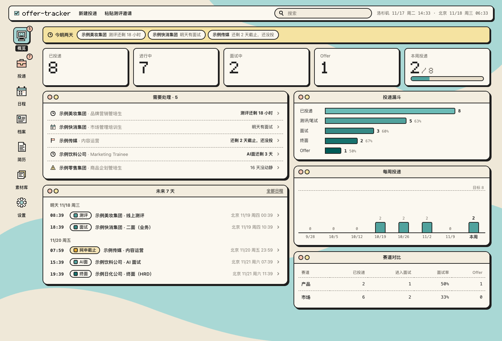
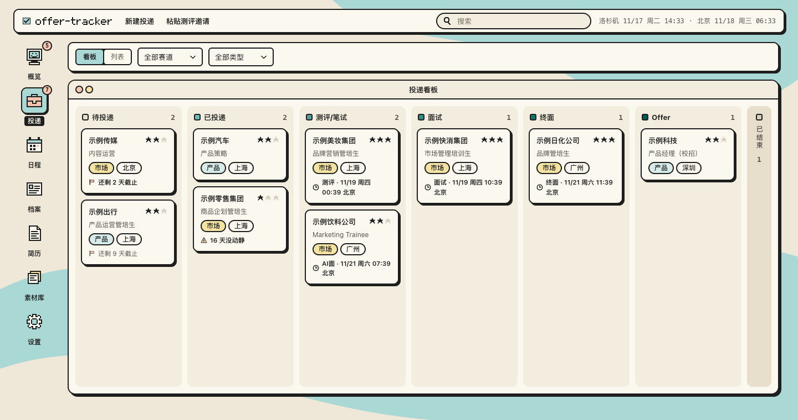
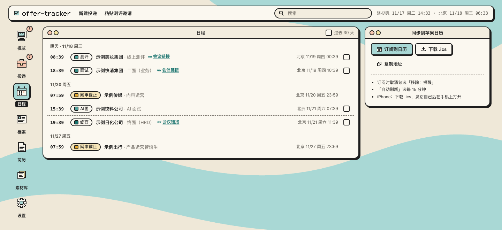
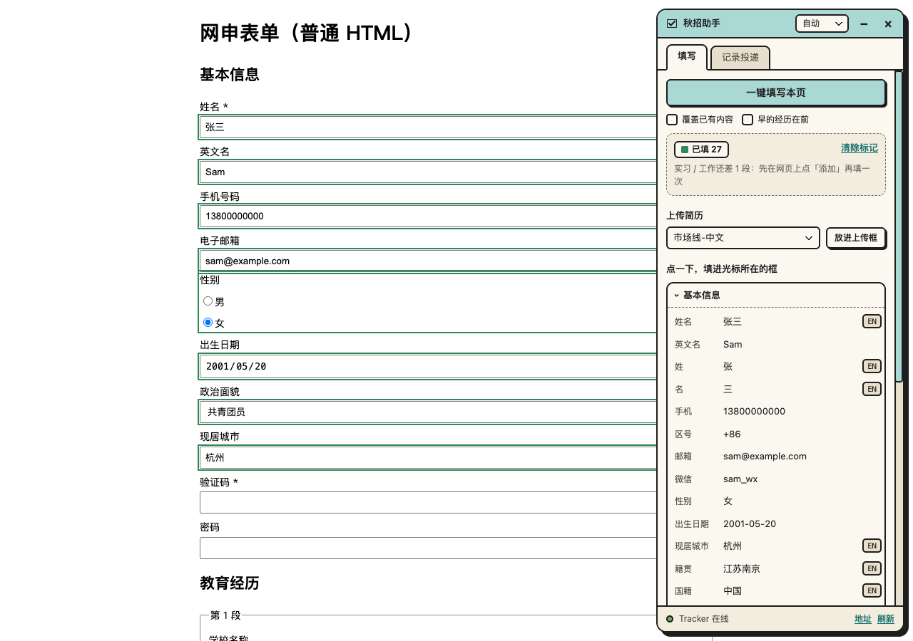

# Offer Tracker (秋招 Tracker)

[简体中文](README.md) · **English**

A job-application tracker for China's autumn campus recruiting season (秋招) that runs on your own computer: a bilingual (Chinese / English) personal profile, résumé versions, an application board, interview schedule and reviews, and a library of answers to application questions. All data stays in the local `data/` folder.

Zero dependencies, no build step: the server uses only the Node standard library, the web app is vanilla JS, and `npm test` runs `node --test`. A companion Chrome extension fills online application forms in one click, puts your résumé into upload fields, and saves job postings as applications. Paste in an assessment invitation email and a time limit like "within 5 days of receiving this email" becomes a calendar event with two alarms, synced to Apple Calendar.

> The interface is in Chinese. Page and button names below are given in Chinese with an English gloss.

## Screenshots

> All screenshots use demo data, not real applications.

The look is a retro desktop: cream paper, black outlines, hard shadows and pixel icons, with every section in a small window with a title bar. Light theme only.

**概览 Overview**: the 「今明两天」 (Today & tomorrow) strip at the top puts the assessments, interviews and application deadlines due in the next two days where you see them first; below are the application funnel, applications per week and a comparison by track. Every time is shown in both your local time zone and the recruiters' time zone.

**投递 Application board**: one column per stage; drag a card to change its stage. Cards show the next event and deadline countdowns.

**日程 Schedule**: assessments, interviews and application deadlines by day, with both time zones side by side. Subscribe in Apple Calendar from the panel on the right; deadline-type events ring twice. 「粘贴测评邀请」 (Paste assessment invite) turns "within 5 days of receiving this email" in an assessment email into an actual date and time.

**Chrome extension**: press ⌥⇧J on an application page to open the side panel and fill the form from your profile in one click. Green outline = filled, blue = please check, yellow = fill it yourself. It never touches password fields or CAPTCHAs, and never clicks submit for you.

## Start and stop

- **Start**: double-click `启动Tracker.command` (Start Tracker); your browser opens <http://127.0.0.1:7317>. You can close the Terminal window afterwards; the Tracker keeps running in the background.
- **Stop**: double-click `停止Tracker.command` (Stop Tracker).
- Requires Node.js 20 or later (check with `node --version`).

The first time you double-click a `.command` file, macOS may refuse to open it. Click "Open Anyway" in System Settings → Privacy & Security, or right-click the file → Open.

## Pages

| Page | What it is for |
|---|---|
| 概览 Overview | Things to deal with, the next 7 days, the application funnel, applications per week |
| 投递 Applications | Board (drag cards between stages) / list; click a card for details: events, interview reviews, JD snapshot, timeline |
| 日程 Schedule | Every assessment, interview and application deadline, in two time zones; subscribe in Apple Calendar |
| 档案 Profile | The personal details application forms ask for, in Chinese and English columns, saved automatically |
| 简历 Résumés | The files for each résumé version |
| 素材库 Answers | Answers to open-ended application questions, with character / word counts |
| 设置 Settings | When to flag an application as gone quiet, weekly goal, time zones, data export |

Shortcuts: `n` new application, `/` search, `Esc` close a dialog.

## Subscribe in Apple Calendar

On the Schedule page, click 「订阅」 (Subscribe). In the subscription dialog, untick "Remove: Alerts", or the calendar won't alert you. Set auto-refresh to every 15 minutes or every hour.

Alarms: interviews alert 1 hour before. Assessments, written tests and AI interviews — anything with a deadline — ring twice: 1 day before, and again at 9 a.m. on the deadline day (2 hours before instead, if the deadline itself is before 9 a.m.).

**No alerts on your phone**: the subscription address is a local address that neither your iPhone nor iCloud can reach. To get alerts on your phone, click 「下载 .ics」 (Download .ics), email the file to yourself, open it on the iPhone and add it to your iCloud calendar; repeat when you add new events. This goes away once the Tracker is deployed online.

## AI (résumé tailoring + interview prep)

Bring your own model service; nothing is tied to one provider. In 设置 → AI 服务 (Settings → AI service), fill in the **API format, base URL, model name and API key**:

- DeepSeek: `https://api.deepseek.com`, model `deepseek-chat`
- Local Ollama: `http://localhost:11434/v1`, the name of the model you pulled, no key
- Claude: choose the Anthropic format, base URL `https://api.anthropic.com`

Click 「测试连接」 (Test connection). Then open the AI tab of any application. It does two things:

- **改简历 Tailor résumé**: checks your experience against each requirement in the JD (hard evidence / partial / missing), lists keywords missing from your résumé, and gives "original → rewritten" cards
- **面试准备 Interview prep**: lists the questions you are most likely to be asked — behavioural, role-specific, motivation, and what you should ask them — each with why it would be asked and which of your experiences to answer with

Below that is a chat box for follow-up requests ("make this one lean more towards channel sales").

**Ground rules**:

- The API key lives only in `data/settings.json` on your machine; the server uses it and the web page never sees it
- Only the JD and the experience entries in your profile are sent to the model; phone number, email, WeChat ID, birthday, ethnicity and political affiliation never are
- The system prompt forbids adding facts and only allows numbers that already appear in your text, and you keep your own list of things that must never appear. If the model still inflates your role or slips in self-praise, a yellow warning appears under the card
- Everything is a suggestion; nothing changes your profile automatically
- Results are cached per application in `data/ai/`, so reopening costs nothing; the model is called again only when the JD changes or you click 「重新生成」 (Regenerate)

## Got an assessment invitation?

**Fastest (recommended)**: select the email body → ⌘C → press your shortcut → a notification confirms what was received, for example "Example Co. · 测评 (assessment) · 11/2 18:00 (Beijing)". It goes into a to-confirm queue shown at the top of the Overview; confirm it when you have a moment and it becomes an event. **Nothing is created automatically**: emails are outside input, and a misread date is more dangerous than none.

Set up the shortcut (once):

1. Open the Shortcuts app and create a new shortcut
2. Search for "**Run Shell Script**", drag it in, and set it to: `bash "<your path>/job-tracker/导入邮件.command"`
3. In Shortcut Details (top right), tick "Use as Quick Action" and set a keyboard shortcut (for example ⌥⌘I)
4. The first run asks for access to the clipboard and permission to send notifications; allow both

Double-clicking `导入邮件.command` (Import email) does the same thing.

**By hand**: no need to work out "within 5 days of receiving this email" or "within 3 working days" yourself. Click 「粘贴测评邀请」 (Paste assessment invite) in the top menu bar and paste the whole email body. It recognises the company, assessment type, duration and link, turns the time limit into an actual date and time, and saves it as an event once you confirm. If it can't find the time limit, it leaves the field empty for you rather than guessing. Only the parsed result is kept, not the email itself.

Once saved, the Today & tomorrow strip on the Overview keeps counting down until you tick the event off on the Schedule page.

## Data and backups

- Everything lives in `data/`: `applications.json` (applications), `profile.json` (profile), `answers.json` (answers), `resumes.json` + `resumes/` (résumés), `jd/` (JD snapshots)
- Each file is backed up at most once every 30 minutes into `data/backups/`, keeping the latest 30. To restore one, copy it back into `data/` under its original name
- Settings can export everything as JSON
- Don't store ID numbers, passport numbers or passwords here

## Using it with Claude

Open Claude Code in this folder and just say things like:

- "Applied to Example Co. for Marketing MT today with the English marketing résumé"
- "Example Co. booked a group interview for Wednesday at 2 p.m."
- "Here is the JD for XX — create an application and check how well my résumé matches"
- "What deadlines and interviews do I have this week?" / "Which applications have gone quiet?"

Claude edits the data following the rules in `AGENTS.md`; if the web page is open, it refreshes within a few seconds.

## Chrome extension (秋招助手)

**Install (once)**

1. Open `chrome://extensions` and turn on "Developer mode" (top right)
2. Click "Load unpacked" and choose the `job-tracker/extension` folder
3. Click the puzzle-piece icon in the toolbar and pin 「秋招助手」

**Use**: on an application page, click the extension icon (or press ⌥⇧J) to open the side panel.

- **一键填写 Fill this page**: matches field labels against your profile and fills them, using the English column on English forms; only empty fields are filled. Green outline = filled, blue = please check, yellow = needs you
- **点选填充 Click to fill**: click a field on the page, then click an item in the side panel (including your answer library) to put it in
- **上传简历 Résumé upload**: pick a version and click 「放进上传框」 (Put in upload field); a PDF is used when the version has one
- **记录投递 Save application**: on a job posting, switch to this tab, check the company and position, and save; the full JD is stored as a snapshot. Postings you've already saved are flagged, and you can change their stage right there

The extension never clicks submit and never touches password fields or CAPTCHAs; logging in and the final submission are up to you. After the extension code changes, click its reload button in `chrome://extensions`.

**Wrong fills?** Custom dropdowns, date pickers and school search boxes differ from site to site and may not fill, or may pick the wrong option. Use click-to-fill for anything outlined in yellow. If an application system is never recognised, give Claude its address so a rule can be added.

## FAQ

- **The page won't open**: the Tracker isn't running; double-click `启动Tracker.command`.
- **"Port already in use"**: a Tracker is already running, so just open <http://127.0.0.1:7317>. If it isn't, double-click `停止Tracker.command` first.
- **"xxx.json is not valid JSON"**: a data file got corrupted. Fix it as the message says, or restore it from `data/backups/`.

## Development

- `npm test` runs the tests; `npm start` runs the server in the foreground
- Zero dependencies, no build: `server/` (Node server), `shared/` (business rules shared by the web app and the server), `web/` (vanilla JS web app)
- Design doc (in Chinese): `docs/superpowers/specs/2026-09-20-job-tracker-design.md`
