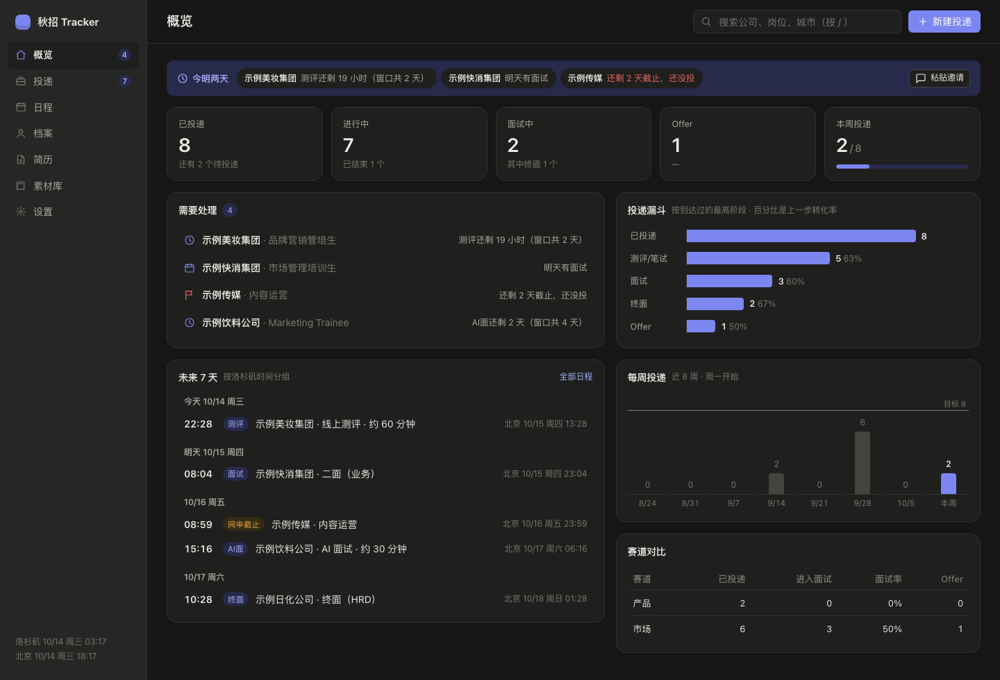
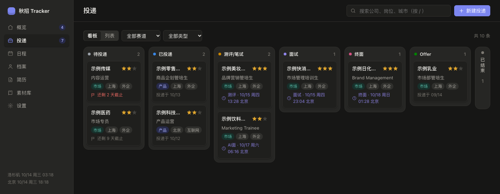
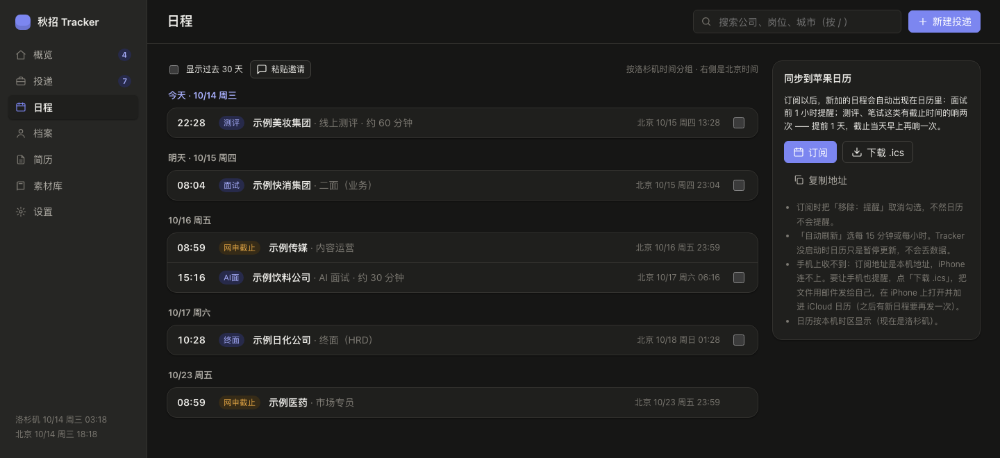
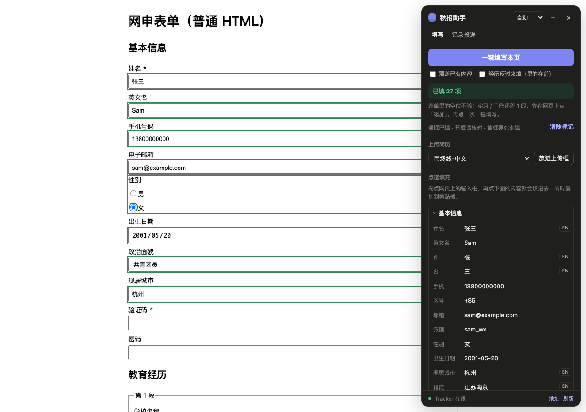

# 秋招 Tracker

在自己电脑上运行的秋招投递管理工具：个人档案（中英对照）、简历版本、投递看板、日程与面试复盘、网申素材库。数据只存在本机的 `data/` 文件夹里。

零依赖、零构建：服务端只用 Node 标准库，网页是原生 JS，`npm test` 跑的是 `node --test`。配套的 Chrome 扩展能一键填网申、把简历放进上传框、把岗位收藏成投递记录；测评邀请邮件粘进来会自动把「收到后 5 天内」这类期限换算成日程，并带两次闹钟同步到苹果日历。

## 界面

> 下面的截图全部用演示数据生成，不是真实投递记录。

**概览**：顶部「今明两天」把今明到期的测评、面试、网申截止摆在第一眼的位置；下面是投递漏斗、每周投递量和赛道对比。所有时间同时显示本地和目标时区。

**投递看板**：按阶段分列，拖动卡片就改阶段；卡片上直接显示下一个日程和截止倒计时。

**日程**：测评、面试、网申截止按天排列，两个时区并排显示；右侧可以订阅到苹果日历，截止型日程会响两次闹钟。「粘贴邀请」能把测评邮件里的「收到后 5 天内」自动换算成具体时间。

**Chrome 扩展**：在网申页按 ⌥⇧J 打开侧边栏，一键按档案填表。绿框是已填、蓝框要核对、黄框要自己填；密码框和验证码永远不碰，也不会替你点提交。

## 启动和停止

- **启动**：双击 `启动Tracker.command`，浏览器会打开 <http://127.0.0.1:7317>。之后可以关掉 Terminal 窗口，Tracker 会继续在后台运行。
- **停止**：双击 `停止Tracker.command`。
- 需要 Node.js 20 或更高版本（`node --version` 查看）。

第一次双击 `.command` 文件时，如果 macOS 提示无法打开，在「系统设置 → 隐私与安全性」里点「仍要打开」，或者右键 → 打开。

## 页面

| 页面 | 用途 |
|---|---|
| 概览 | 需要处理的事、未来 7 天的日程、投递漏斗、每周投递量 |
| 投递 | 看板（拖动卡片改阶段）/ 列表；点卡片看详情：日程、复盘、JD 快照、时间线 |
| 日程 | 所有测评、面试、网申截止；同时显示两个时区；可订阅到苹果日历 |
| 档案 | 网申要填的个人信息，中英两栏，自动保存 |
| 简历 | 各个版本的简历文件 |
| 素材库 | 网申开放题的答案，带字数统计 |
| 设置 | 没动静提醒天数、周目标、时区、导出数据 |

快捷键：`n` 新建投递，`/` 搜索，`Esc` 关闭弹窗。

## 订阅到苹果日历

「日程」页点「订阅」。订阅对话框里记得把「移除：提醒」取消勾选，不然日历不会提醒。自动刷新选每 15 分钟或每小时。

闹钟：面试提前 1 小时；测评、笔试、AI 面这类有截止时间的响两次 —— 提前 1 天，截止当天早上 9 点再响一次（截止本身就在早上 9 点前的话，改成提前 2 小时）。

**手机上收不到**：订阅地址是本机地址，iPhone 连不上，iCloud 也抓不到。要让手机提醒，点「下载 .ics」，把文件用邮件发给自己，在 iPhone 上打开并加进 iCloud 日历；之后有新日程要再发一次。以后 Tracker 部署到公网就不用这么麻烦了。

## 收到测评邀请怎么办

邀请邮件里的「收到后 5 天内」「3 个工作日内」不用自己算。在「日程」页（或概览顶部那条）点「粘贴邀请」，把邮件正文整段粘进去，会自动认出公司、测评类型、时长、链接，并把期限换算成具体时间，确认后存成日程。认不出期限时会留空让你手填，不会瞎猜。只存解析结果，不保存邮件原文。

存进去之后：概览顶部的「今明两天」会一直显示倒计时，直到你在「日程」页把它勾成已完成。

## 数据和备份

- 所有数据在 `data/`：`applications.json`（投递）、`profile.json`（档案）、`answers.json`（素材库）、`resumes.json` + `resumes/`（简历）、`jd/`（JD 快照）
- 同一个文件 30 分钟内最多自动备份一次，放在 `data/backups/`，保留最近 30 份。要恢复就把备份文件复制回 `data/` 并改回原文件名
- 「设置」页可以导出全部数据（JSON）
- 不要在这里存身份证号、护照号和密码

## 和 Claude 一起用

在 Life Agent 里直接说就行，比如：

- 「今天投了示例公司 Marketing MT，用的市场线英文简历」
- 「示例公司约了周三下午两点群面」
- 「这是 XX 的 JD，帮我建一条记录，再对照简历看看匹配度」
- 「这周有哪些截止和面试？」「哪些投递很久没动静了？」

Claude 会按 `CLAUDE.md` 里的规则直接修改数据，网页开着的话几秒内会自动刷新。

## Chrome 插件（秋招助手）

**安装（只要做一次）**

1. Chrome 地址栏打开 `chrome://extensions`，打开右上角的「开发者模式」
2. 点「加载已解压的扩展程序」，选 `job-tracker/extension` 文件夹
3. 点工具栏的拼图图标，把「秋招助手」固定出来

**使用**：在网申页面点插件图标（或按 ⌥⇧J）打开侧边栏。

- **一键填写**：按字段名匹配档案来填，英文表单用英文栏；只填空着的框。绿框 = 已填，蓝框 = 请核对，黄框 = 需要你来填
- **点选填充**：先点网页上的输入框，再点侧边栏里的内容（包括素材库），就会填进去
- **上传简历**：选好版本，点「放进上传框」（有 PDF 时优先用 PDF）
- **记录投递**：在招聘详情页切到「记录投递」，确认公司、岗位后保存，JD 全文会一起存成快照；已经记过的会提示，还能直接改阶段

插件不会点提交按钮，也不碰密码框和验证码，登录和最后提交都由你来。插件代码更新后，在 `chrome://extensions` 里点它的「重新加载」。

**填得不对？** 各家的自定义下拉、日期控件、学校搜索框做法不同，可能填不上或选错；标黄的地方用点选填充补上。遇到总是认不出的网申系统，把页面地址告诉 Claude 加规则。

## 常见问题

- **页面打不开**：Tracker 没在运行，双击 `启动Tracker.command`。
- **提示端口被占用**：已经有一个 Tracker 在运行，直接打开 <http://127.0.0.1:7317>；不是的话先双击 `停止Tracker.command`。
- **页面报「xxx.json 不是有效的 JSON」**：数据文件被改坏了。按提示修好，或者从 `data/backups/` 恢复。

## 开发

- `npm test` 运行测试；`npm start` 前台启动服务
- 零依赖、无构建：`server/`（Node 服务）、`shared/`（网页和服务端共用的业务规则）、`web/`（原生 JS 网页）
- 设计文档：`docs/superpowers/specs/2026-09-20-job-tracker-design.md`
